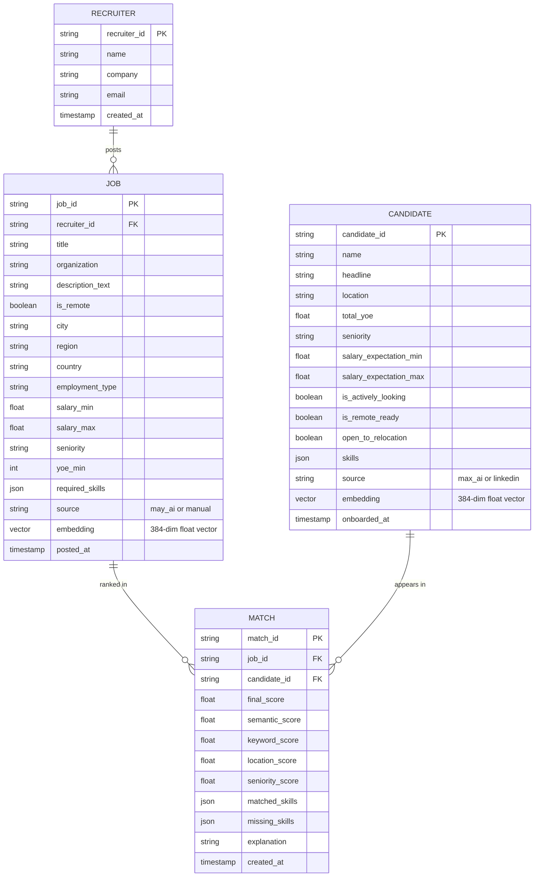
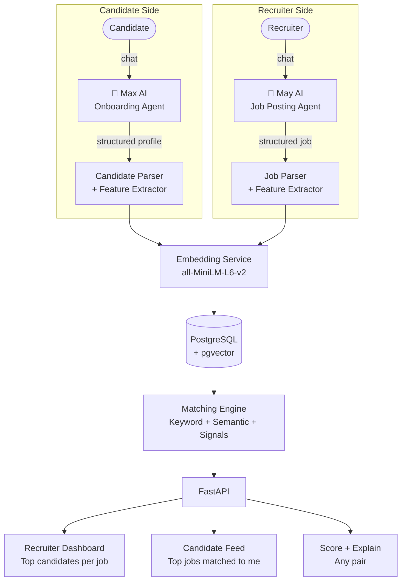

# Job ↔ Candidate Matching Algorithm
### Technical Pitch

---

## 1. The Problem

> **Recruiters waste 70% of screening time on irrelevant candidates.**
> **Candidates apply to jobs they are not qualified for.**

Standard platforms rely on keyword search alone — they miss meaning, context, and real fit.
And the data collection problem is just as bad: candidates fill out forms, recruiters copy-paste descriptions, and critical information gets lost.

---

## 2. The Two AI Agents

Two conversational agents power the **data collection layer** — replacing manual forms and CSV uploads entirely.

```
┌──────────────────────────────┐     ┌──────────────────────────────┐
│         MAX AI               │     │          MAY AI              │
│    Candidate Onboarding      │     │    Recruiter Job Posting      │
├──────────────────────────────┤     ├──────────────────────────────┤
│                              │     │                              │
│  "Hi! I'm Max. Let's build   │     │  "Hi! I'm May. Tell me about │
│   your profile together."    │     │   the role you're hiring for"│
│                              │     │                              │
│  Collects via conversation:  │     │  Collects via conversation:  │
│  · Skills & tech stack       │     │  · Job title & description   │
│  · Years of experience       │     │  · Required skills           │
│  · Current role & company    │     │  · Seniority & YoE needed    │
│  · Location & remote prefs   │     │  · Salary range              │
│  · Job seeking status        │     │  · Location / remote policy  │
│  · Salary expectations       │     │  · Employment type           │
│  · Open to relocation?       │     │                              │
│                              │     │  Publishes job → DB          │
│  Saves structured candidate  │     │  Triggers matching engine    │
│  profile → DB                │     │  Shows recruiter dashboard   │
└──────────────────────────────┘     └──────────────────────────────┘
         │                                       │
         ▼                                       ▼
   Candidate Store                          Job Store
         │                                       │
         └──────────────┬────────────────────────┘
                        │
               [ Matching Engine ]
                        │
              Ranked Scores 0.0 → 1.0
```

---

## 3. The Solution — Hybrid Matching

The engine combines **three intelligence layers** into one score:

```
┌──────────────────────────────────────────────────────────┐
│                                                          │
│  May AI → Job Profile  ──►  Matching Engine  ◄──  Max AI → Candidate  │
│                                                          │
│   [ Keyword Layer ]   Skills overlap (50+ tech terms)   │
│   [ Semantic Layer ]  Meaning & context via embeddings   │
│   [ Signals Layer ]   Location · Seniority · YoE        │
│                                                          │
│                    ▼                                     │
│             Ranked Match Score  0.0 → 1.0                │
│             + Explanation  (why this match)              │
└──────────────────────────────────────────────────────────┘
```

---

## 4. The 4 Scoring Factors

| # | Factor | Weight | What it measures |
|---|--------|--------|-----------------|
| 1 | **Semantic Similarity** | 40% | Deep meaning match between job description and candidate profile using AI embeddings |
| 2 | **Skill Overlap** | 35% | % of required job skills the candidate has (50+ technologies tracked with aliases) |
| 3 | **Location Fit** | 15% | Remote-first, then city → state → country proximity |
| 4 | **Seniority Match** | 10% | How close candidate level is to what the job requires |

### Score Formula

```
final_score = (0.40 × semantic)
            + (0.35 × keyword)
            + (0.15 × location)
            + (0.10 × seniority)
```

> Weights are **tunable** — adjustable per client or role type.

---

## 4. How Each Score Works

### 4.1 Semantic Score (AI Embeddings)

```
Job Description Text  ──► [ Embedding Model ] ──► Vector A (384 dims)
Candidate Profile     ──► [ Embedding Model ] ──► Vector B (384 dims)

                Semantic Score = cosine_similarity(A, B)
```

- Model: `all-MiniLM-L6-v2` — runs **fully local**, no API needed
- Captures: synonyms, context, domain knowledge
- Example: "distributed systems" matches "Apache Kafka, microservices"

---

### 4.2 Skill Score (Keyword Matching)

```
Job Required Skills:   [ python, react, postgresql, docker ]
Candidate Skills:      [ python, react, aws, docker, typescript ]

Matched  = { python, react, docker }       → 3
Missing  = { postgresql }                  → 1

Keyword Score = matched / total_required = 3/4 = 0.75
```

- 50+ tech skills tracked with **alias normalisation**
  - `k8s` = `kubernetes`, `JS` = `JavaScript`, `Postgres` = `PostgreSQL`
- Extracts skills from raw free text automatically

---

### 4.3 Location Score

```
Job is Remote?           ──► 1.0  (perfect)
Candidate open to relocate? ──► 0.8
Same City?               ──► 1.0
Same State/Region?       ──► 0.7
Same Country?            ──► 0.5
Different Country?       ──► 0.3
```

---

### 4.4 Seniority Score

```
Seniority Ladder:  intern → junior → mid → senior → staff → lead → principal

Job requires:  senior  (index 3)
Candidate is:  senior  (index 3)  →  diff = 0  →  1.0
Candidate is:  mid     (index 2)  →  diff = 1  →  0.7
Candidate is:  junior  (index 1)  →  diff = 2  →  0.4
```

---

## 5. Database Schema



> **Vector column** via `pgvector` — fast ANN queries at scale.  
> `source` field tracks whether data came from **Max AI**, **May AI**, or manual import.

---

## 6. Backend Architecture



---

## 7. API Design

### Agent Endpoints
| Endpoint | Agent | Purpose |
|---|---|---|
| `POST /agent/max/chat` | Max AI | Conversational candidate onboarding turn |
| `POST /agent/max/submit` | Max AI | Finalise & save candidate profile |
| `POST /agent/may/chat` | May AI | Conversational job posting turn |
| `POST /agent/may/submit` | May AI | Publish job & trigger matching |

### Matching Endpoints
| Endpoint | Who uses it | Returns |
|---|---|---|
| `GET /dashboard/recruiter/{recruiter_id}` | **May AI / Recruiter** | All posted jobs + top-5 candidates each |
| `GET /match/job/{job_id}?top=10` | Recruiter | Ranked candidates for one job |
| `GET /match/candidate/{id}?top=10` | Candidate | Ranked jobs for one candidate |
| `POST /score` | Internal | Score any job ↔ candidate pair |
| `GET /explain/{job_id}/{cand_id}` | Debug | Human-readable explanation |

### Recruiter Dashboard Response

```json
{
  "recruiter_id": "rec_001",
  "jobs": [
    {
      "job_id": "2042126856",
      "title": "Senior Software Engineer",
      "posted_at": "2026-03-04",
      "total_applicants": 0,
      "top_candidates": [
        {
          "name": "Shreyas Chaudhary",
          "final_score": 0.729,
          "matched_skills": ["python", "react", "typescript"],
          "missing_skills": [],
          "is_actively_looking": true,
          "explanation": "All required skills matched. Open to relocation."
        }
      ]
    }
  ]
}
```

---

## 8. Tech Stack

```
┌─────────────────────────────────────────────────────────────┐
│  Layer             Tool                    Why               │
├─────────────────────────────────────────────────────────────┤
│  AI Agents         LLM (GPT-4o / local)    Conversational    │
│  Agent Framework   LangChain / LlamaIndex  Tool use + memory │
│  Embeddings        sentence-transformers   Local, no API fee  │
│  Vector Store      PostgreSQL + pgvector   One DB for all     │
│  Keyword Match     Custom regex + sklearn  Lightweight        │
│  API               FastAPI                 Async, typed       │
│  Agent Memory      Redis                   Session context    │
│  Cache             Redis                   Top-N match cache  │
└─────────────────────────────────────────────────────────────┘
```

---

## 9. What Makes This Different

| Standard Search | Our Matching |
|---|---|
| Keyword-only | Keyword **+** Semantic |
| Boolean match | Graded score 0–1 |
| No explanation | Shows matched/missing skills |
| Single direction | Job→Candidates **and** Candidate→Jobs |
| Hard filters only | Soft scoring + hard filters |
| No learning | Weights tunable per client |

---

## 10. User Journeys

### Max AI — Candidate
```
Candidate opens app
  └─► Max AI says "Hi! I'm Max. Let's build your profile."
        └─► Asks: skills, experience, location, salary expectations
              └─► Saves structured profile → DB
                    └─► Matching engine runs automatically
                          └─► Candidate sees "Your top job matches"
```

### May AI — Recruiter
```
Recruiter opens app
  └─► May AI says "Hi! I'm May. What role are you hiring for?"
        └─► Asks: title, requirements, skills, salary, location
              └─► Publishes job → DB
                    └─► Matching engine runs on all candidates
                          └─► Recruiter Dashboard shows top matches
                                └─► Recruiter reviews, shortlists, contacts
```

---

Local Testing using python script
I took both the CSVs and created a python script to test the matching engine, 
Currently it's testing 100 jobs and 100 candidates, its base algorithm, will be updated after I see the full intergration of hiretal.ai, But it takes care of matching job and candidate effectively.
gives overall idea of how the matching engine will work.

below are some test cases I ran and the output:

zsh -lc 'source .venv/bin/activate && python test_matching.py'


================================================================================
INTEGRATION TEST 3 — Job → Top-5 Candidates
================================================================================

------------------------------------------------------------
JOB: [2042126856]

  Title      : Senior Software Engineer
  Company    : Pair Team
  Remote     : True  |  Location : nan, nan
  Seniority  : senior  |  YoE req  : 2
  Salary     : $nan–$nan nan
  Skills (8) : aws, golang, react, ruby, ruby_on_rails, rust, scala, typescript

  Top 5 matching candidates:

  #1  Daniel Rowe
      Score  : 0.587  ███████████
      Breakdown: semantic=0.406  keyword=0.500  location=1.000  seniority=1.000
      YoE: 8.0  |  Seniority: senior  |  Actively looking: True  |  Location: Washington DC-Baltimore Area (US)
      Matched skills : react, ruby, rust, typescript
      Missing skills : aws, golang, ruby_on_rails, scala

  #2  Dilande Roger
      Score  : 0.568  ███████████
      Breakdown: semantic=0.357  keyword=0.500  location=1.000  seniority=1.000
      YoE: 25.7  |  Seniority: senior  |  Actively looking: False  |  Location: Bowie, Maryland, United States (US)
      Matched skills : aws, golang, scala, typescript
      Missing skills : react, ruby, ruby_on_rails, rust

  #3  David P.
      Score  : 0.547  ██████████
      Breakdown: semantic=0.321  keyword=0.625  location=1.000  seniority=0.500
      YoE: 4.5  |  Seniority: None  |  Actively looking: False  |  Location: Gilbert, Arizona, United States (US)
      Matched skills : aws, golang, react, scala, typescript
      Missing skills : ruby, ruby_on_rails, rust

  #4  Kevin Buchs
      Score  : 0.539  ██████████
      Breakdown: semantic=0.300  keyword=0.625  location=1.000  seniority=0.500
      YoE: 22.8  |  Seniority: None  |  Actively looking: True  |  Location: United States (US)
      Matched skills : aws, golang, ruby, rust, typescript
      Missing skills : react, ruby_on_rails, scala

  #5  Amanda Mitchell
      Score  : 0.538  ██████████
      Breakdown: semantic=0.392  keyword=0.375  location=1.000  seniority=1.000
      YoE: 16.0  |  Seniority: senior  |  Actively looking: False  |  Location: Senior Software Engineer, Ex-Indeed
      Matched skills : aws, rust, typescript
      Missing skills : golang, react, ruby, ruby_on_rails, scala

------------------------------------------------------------
JOB: [2041487300]

  Title      : Senior Software Engineer
  Company    : Beacon EmbeddedWorks
  Remote     : False  |  Location : Eden Prairie, Minnesota
  Seniority  : senior  |  YoE req  : 2
  Salary     : $nan–$nan nan
  Skills (9) : agile, cpp, csharp, embedded, golang, java, linux, python, typescript

  Top 5 matching candidates:

  #1  Ken Link
      Score  : 0.608  ████████████
      Breakdown: semantic=0.425  keyword=0.667  location=0.700  seniority=1.000
      YoE: 18.5  |  Seniority: senior  |  Actively looking: False  |  Location: Minneapolis, Minnesota, United States (US)
      Matched skills : agile, cpp, csharp, linux, python, typescript
      Missing skills : embedded, golang, java

  #2  Bryce M.
      Score  : 0.572  ███████████
      Breakdown: semantic=0.437  keyword=0.778  location=0.500  seniority=0.500
      YoE: 10.6  |  Seniority: None  |  Actively looking: False  |  Location: Sparks, Nevada, United States (US)
      Matched skills : agile, cpp, csharp, java, linux, python, typescript
      Missing skills : embedded, golang

  #3  Kevin Buchs
      Score  : 0.547  ██████████
      Breakdown: semantic=0.375  keyword=0.778  location=0.500  seniority=0.500
      YoE: 22.8  |  Seniority: None  |  Actively looking: True  |  Location: United States (US)
      Matched skills : cpp, csharp, golang, java, linux, python, typescript
      Missing skills : agile, embedded

  #4  Alex Evans
      Score  : 0.521  ██████████
      Breakdown: semantic=0.408  keyword=0.667  location=0.500  seniority=0.500
      YoE: 5.6  |  Seniority: None  |  Actively looking: False  |  Location: Sioux Falls, South Dakota, United States (US)
      Matched skills : cpp, csharp, embedded, linux, python, typescript
      Missing skills : agile, golang, java

  #5  Kevin Burke
      Score  : 0.518  ██████████
      Breakdown: semantic=0.349  keyword=0.667  location=0.300  seniority=1.000
      YoE: 8.9  |  Seniority: senior  |  Actively looking: False  |  Location: Charlotte Metro (US)
      Matched skills : agile, cpp, csharp, java, linux, typescript
      Missing skills : embedded, golang, python

------------------------------------------------------------
JOB: [2041973140]

  Title      : Senior Software Engineer, Risk Engineering
  Company    : Flex
  Remote     : True  |  Location : nan, nan
  Seniority  : senior  |  YoE req  : None
  Salary     : $nan–$nan nan
  Skills (12) : aws, cicd, git, java, junit, machine_learning, rest, scala, snowflake, spring, terraform, typescript

  Top 5 matching candidates:

  #1  Circe Morningstar
      Score  : 0.616  ████████████
      Breakdown: semantic=0.458  keyword=0.667  location=1.000  seniority=0.500
      YoE: 5.2  |  Seniority: None  |  Actively looking: True  |  Location: Worcester, Massachusetts, United States (US)
      Matched skills : aws, cicd, git, java, junit, snowflake, spring, typescript
      Missing skills : machine_learning, rest, scala, terraform

  #2  Scott Laughlin
      Score  : 0.610  ████████████
      Breakdown: semantic=0.514  keyword=0.583  location=1.000  seniority=0.500
      YoE: 16.4  |  Seniority: None  |  Actively looking: False  |  Location: Dallas-Fort Worth Metroplex (US)
      Matched skills : aws, cicd, git, java, junit, rest, typescript
      Missing skills : machine_learning, scala, snowflake, spring, terraform

  #3  Dilande Roger
      Score  : 0.588  ███████████
      Breakdown: semantic=0.479  keyword=0.417  location=1.000  seniority=1.000
      YoE: 25.7  |  Seniority: senior  |  Actively looking: False  |  Location: Bowie, Maryland, United States (US)
      Matched skills : aws, git, java, scala, typescript
      Missing skills : cicd, junit, machine_learning, rest, snowflake, spring, terraform

  #4  Michael Sargent
      Score  : 0.587  ███████████
      Breakdown: semantic=0.477  keyword=0.417  location=1.000  seniority=1.000
      YoE: 29.4  |  Seniority: senior  |  Actively looking: False  |  Location: Hanahan, South Carolina, United States (US)
      Matched skills : cicd, git, java, rest, typescript
      Missing skills : aws, junit, machine_learning, scala, snowflake, spring, terraform

  #5  Amanda Mitchell
      Score  : 0.578  ███████████
      Breakdown: semantic=0.454  keyword=0.417  location=1.000  seniority=1.000
      YoE: 16.0  |  Seniority: senior  |  Actively looking: False  |  Location: Senior Software Engineer, Ex-Indeed
      Matched skills : aws, cicd, git, java, typescript
      Missing skills : junit, machine_learning, rest, scala, snowflake, spring, terraform

  ✓ Job→Candidates matching complete

================================================================================
INTEGRATION TEST 4 — Candidate → Top-5 Jobs
================================================================================

------------------------------------------------------------
CANDIDATE: [uday-ram-022427192]

  Name       : Uday Ram
  Headline   : Uday Ram | Senior Software Engineer | Actively looking for new opportunities
  Location   : Hutto, Texas, United States (US)
  YoE        : 7.4  |  Seniority : senior
  Flags      : actively_looking=True  remote_ready=False  relocate=False
  Skills (3) : aws, java, typescript

  Top 5 matching jobs:

  #1  Systems & Software Engineer  @  OLED Technologies
      Score  : 0.680  █████████████
      Breakdown: semantic=0.511  keyword=1.000  location=0.500  seniority=0.500
      Remote: False  |  Location: Rochester, New York  |  Salary: $70,000–$80,000 USD  |  Seniority: None  |  YoE req: None
      Matched skills : typescript
      Missing skills : none

  #2  Principal Software Engineer  @  i3 Assembly
      Score  : 0.603  ████████████
      Breakdown: semantic=0.419  keyword=1.000  location=0.500  seniority=0.100
      Remote: False  |  Location: Boxborough, Massachusetts  |  Salary: $143,000–$150,000 USD  |  Seniority: principal  |  YoE req: None
      Matched skills : typescript
      Missing skills : none

  #3   Senior Software Engineer  @  Pebl
      Score  : 0.593  ███████████
      Breakdown: semantic=0.567  keyword=0.333  location=1.000  seniority=1.000
      Remote: True  |  Location: Palo Alto, California  |  Salary: $150,000–$185,000 USD  |  Seniority: senior  |  YoE req: 5
      Matched skills : aws, typescript
      Missing skills : microservices, postgresql, rest, scala

  #4  Senior Software Engineer, Growth  @  Posh
      Score  : 0.578  ███████████
      Breakdown: semantic=0.469  keyword=0.400  location=1.000  seniority=1.000
      Remote: True  |  Location: New York, New York  |  Salary: $180,000–$220,000 USD  |  Seniority: senior  |  YoE req: 5
      Matched skills : aws, typescript
      Missing skills : react, rust, scala

  #5  Senior Software Engineer, Backend  @  Apella
      Score  : 0.531  ██████████
      Breakdown: semantic=0.501  keyword=0.231  location=1.000  seniority=1.000
      Remote: True  |  Location: nan, nan  |  Salary: $175,000–$200,000 USD  |  Seniority: senior  |  YoE req: 4
      Matched skills : aws, java, typescript
      Missing skills : cicd, gcp, golang, graphql, grpc, kafka, machine_learning, python, scala, sql

------------------------------------------------------------
CANDIDATE: [shreyas-chaudhary-599839262]

  Name       : Shreyas Chaudhary
  Headline   : Shreyas Chaudhary | Looking for SWE/SDE roles | Software Engineer | Full Stack Developer |
  Location   : Greater Chicago Area (US)
  YoE        : 1.8  |  Seniority : intern
  Flags      : actively_looking=True  remote_ready=False  relocate=True
  Skills (16) : agile, azure, databricks, git, java, javascript, junit, kubernetes, machine_learning, microservices, python, react

  Top 5 matching jobs:

  #1  Software Engineer (Junior/Intermediate)  @  Automat, Inc.
      Score  : 0.729  ██████████████
      Breakdown: semantic=0.473  keyword=1.000  location=0.800  seniority=0.700
      Remote: False  |  Location: San Francisco, California  |  Salary: $150,000–$200,000 USD  |  Seniority: junior  |  YoE req: None
      Matched skills : javascript, scala, typescript
      Missing skills : none

  #2  Systems & Software Engineer  @  OLED Technologies
      Score  : 0.729  ██████████████
      Breakdown: semantic=0.522  keyword=1.000  location=0.800  seniority=0.500
      Remote: False  |  Location: Rochester, New York  |  Salary: $70,000–$80,000 USD  |  Seniority: None  |  YoE req: None
      Matched skills : typescript
      Missing skills : none

  #3  Software engineer, full-stack  @  Watershed
      Score  : 0.703  ██████████████
      Breakdown: semantic=0.458  keyword=1.000  location=0.800  seniority=0.500
      Remote: False  |  Location: Denver, Colorado  |  Salary: $165,000–$200,000 USD  |  Seniority: None  |  YoE req: None
      Matched skills : javascript, react, scala, typescript
      Missing skills : none

  #4  Software Engineer, Insights  @  Benchling
      Score  : 0.692  █████████████
      Breakdown: semantic=0.355  keyword=1.000  location=1.000  seniority=0.500
      Remote: True  |  Location: San Francisco, California  |  Salary: $nan–$nan nan  |  Seniority: None  |  YoE req: 2
      Matched skills : machine_learning, typescript
      Missing skills : none

  #5  Software Engineer, Domains  @  Vercel
      Score  : 0.670  █████████████
      Breakdown: semantic=0.476  keyword=0.800  location=1.000  seniority=0.500
      Remote: True  |  Location: nan, nan  |  Salary: $nan–$nan nan  |  Seniority: None  |  YoE req: None
      Matched skills : javascript, react, rest, typescript
      Missing skills : rust

------------------------------------------------------------
CANDIDATE: [pranshu-chawla-]

  Name       : Pranshu Chawla
  Headline   : Pranshu Chawla | Software Engineer | Full-Stack Developer (Next.js, Node.js, PostgreSQL) |
  Location   : Seattle, Washington, United States (US)
  YoE        : 3.9  |  Seniority : junior
  Flags      : actively_looking=True  remote_ready=False  relocate=False
  Skills (9) : agile, cpp, git, golang, javascript, postgresql, react, scala, typescript

  Top 5 matching jobs:

  #1  Software Engineer (Junior/Intermediate)  @  Automat, Inc.
      Score  : 0.693  █████████████
      Breakdown: semantic=0.420  keyword=1.000  location=0.500  seniority=1.000
      Remote: False  |  Location: San Francisco, California  |  Salary: $150,000–$200,000 USD  |  Seniority: junior  |  YoE req: None
      Matched skills : javascript, scala, typescript
      Missing skills : none

  #2  Software engineer, full-stack  @  Watershed
      Score  : 0.657  █████████████
      Breakdown: semantic=0.454  keyword=1.000  location=0.500  seniority=0.500
      Remote: False  |  Location: Denver, Colorado  |  Salary: $165,000–$200,000 USD  |  Seniority: None  |  YoE req: None
      Matched skills : javascript, react, scala, typescript
      Missing skills : none

  #3  Systems & Software Engineer  @  OLED Technologies
      Score  : 0.651  █████████████
      Breakdown: semantic=0.440  keyword=1.000  location=0.500  seniority=0.500
      Remote: False  |  Location: Rochester, New York  |  Salary: $70,000–$80,000 USD  |  Seniority: None  |  YoE req: None
      Matched skills : typescript
      Missing skills : none

  #4  Software Engineer, Domains  @  Vercel
      Score  : 0.626  ████████████
      Breakdown: semantic=0.540  keyword=0.600  location=1.000  seniority=0.500
      Remote: True  |  Location: nan, nan  |  Salary: $nan–$nan nan  |  Seniority: None  |  YoE req: None
      Matched skills : javascript, react, typescript
      Missing skills : rest, rust

  #5  Software Engineer III (React Native)  @  PrizePicks
      Score  : 0.611  ████████████
      Breakdown: semantic=0.445  keyword=0.667  location=1.000  seniority=0.500
      Remote: True  |  Location: Atlanta, Georgia  |  Salary: $nan–$nan nan  |  Seniority: None  |  YoE req: None
      Matched skills : react, typescript
      Missing skills : cicd

  ✓ Candidate→Jobs matching complete

================================================================================
INTEGRATION TEST 5 — Edge Cases
================================================================================

  ✓ Unknown job_id raises ValueError: job_id 'non_existent_id_999' not found.
  ✓ Unknown candidate_id raises ValueError: candidate_id 'https://fake.url/person/nobody' not found.

  Sparse candidate against 'Senior Software Engineer':
    keyword=0.0  location=1.0  seniority=0.5  final≈0.4
  ✓ Sparse profile handled gracefully (no crash)

  ✓ All edge cases passed

================================================================================
ALL TESTS PASSED
================================================================================
dhawal@Dhawals-MacBook-Air matching % zsh -lc 'source .venv/bin/activate && python test_matching
.py 2>&1 | tail -60'
  Location   : Seattle, Washington, United States (US)
  YoE        : 3.9  |  Seniority : junior
  Flags      : actively_looking=True  remote_ready=False  relocate=False
  Skills (9) : agile, cpp, git, golang, javascript, postgresql, react, scala, typescript

  Top 5 matching jobs:

  #1  Software Engineer (Junior/Intermediate)  @  Automat, Inc.
      Score  : 0.693  █████████████
      Breakdown: semantic=0.420  keyword=1.000  location=0.500  seniority=1.000
      Remote: False  |  Location: San Francisco, California  |  Salary: $150,000–$200,000 USD  |  Seniority: junior  |  YoE req: None
      Matched skills : javascript, scala, typescript
      Missing skills : none

  #2  Software engineer, full-stack  @  Watershed
      Score  : 0.657  █████████████
      Breakdown: semantic=0.454  keyword=1.000  location=0.500  seniority=0.500
      Remote: False  |  Location: Denver, Colorado  |  Salary: $165,000–$200,000 USD  |  Seniority: None  |  YoE req: None
      Matched skills : javascript, react, scala, typescript
      Missing skills : none

  #3  Systems & Software Engineer  @  OLED Technologies
      Score  : 0.651  █████████████
      Breakdown: semantic=0.440  keyword=1.000  location=0.500  seniority=0.500
      Remote: False  |  Location: Rochester, New York  |  Salary: $70,000–$80,000 USD  |  Seniority: None  |  YoE req: None
      Matched skills : typescript
      Missing skills : none

  #4  Software Engineer, Domains  @  Vercel
      Score  : 0.626  ████████████
      Breakdown: semantic=0.540  keyword=0.600  location=1.000  seniority=0.500
      Remote: True  |  Location: nan, nan  |  Salary: N/A  |  Seniority: None  |  YoE req: None
      Matched skills : javascript, react, typescript
      Missing skills : rest, rust

  #5  Software Engineer III (React Native)  @  PrizePicks
      Score  : 0.611  ████████████
      Breakdown: semantic=0.445  keyword=0.667  location=1.000  seniority=0.500
      Remote: True  |  Location: Atlanta, Georgia  |  Salary: N/A  |  Seniority: None  |  YoE req: None
      Matched skills : react, typescript
      Missing skills : cicd

  ✓ Candidate→Jobs matching complete

================================================================================
INTEGRATION TEST 5 — Edge Cases
================================================================================

  ✓ Unknown job_id raises ValueError: job_id 'non_existent_id_999' not found.
  ✓ Unknown candidate_id raises ValueError: candidate_id 'https://fake.url/person/nobody' not found.

  Sparse candidate against 'Senior Software Engineer':
    keyword=0.0  location=1.0  seniority=0.5  final≈0.4
  ✓ Sparse profile handled gracefully (no crash)

  ✓ All edge cases passed

================================================================================
ALL TESTS PASSED
================================================================================
